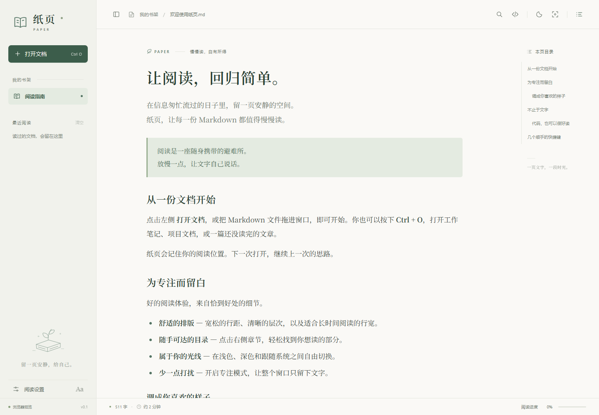
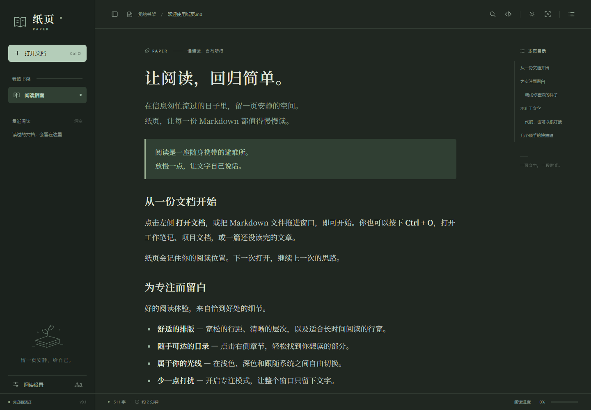

# 纸页 Paper

一个以安静阅读为中心的 Markdown 桌面阅读器。Rust 负责文件操作与 Markdown 解析，Tauri 2 使用系统 WebView，界面采用原生 HTML、CSS 和 JavaScript。



<details>

<summary>查看深色主题</summary>



</details>

本地构建的 Windows 便携版可放在 `release/Paper/Paper.exe`，双击即可运行。若使用 GNU 构建，请保留同目录的 `WebView2Loader.dll`；系统需要已安装 WebView2 Runtime。源码仓库不包含本地二进制和开发工具链，可按下文自行构建，或从 GitHub Actions 的成功构建下载产物。

## 功能

- 打开、拖放 `.md`、`.markdown`、`.mdown`、`.txt` 文件；支持启动时传入文件路径。
- 自动章节目录、阅读进度、最近阅读、阅读位置恢复。
- 文内搜索及上一个 / 下一个结果、源码查看、代码复制。
- 浅色、深色、跟随系统主题；字号、行宽、专注模式。
- 表格、任务列表、删除线、代码块；桌面端支持脚注。
- 本地相对图片和 Markdown 链接；远程图片点击后加载。
- 无账户、遥测、在线字体、常驻扫描或文档内容持久化缓存。

## 运行桌面版

Windows 需要 Rust 工具链、对应 C/C++ 链接工具，以及 Microsoft Edge WebView2 Runtime。标准开发环境建议使用 Rust MSVC + Visual Studio Build Tools 的“使用 C++ 的桌面开发”组件，参考 [Tauri 官方前置依赖](https://v2.tauri.app/start/prerequisites/)。

```powershell
cargo run --manifest-path src-tauri/Cargo.toml
```

打开指定文档：

```powershell
cargo run --manifest-path src-tauri/Cargo.toml -- "D:\notes\readme.md"
```

生成便携可执行文件（系统须有 WebView2）：

```powershell
cargo build --release --manifest-path src-tauri/Cargo.toml
.\src-tauri\target\release\paper-reader.exe
```

本项目也提供隔离构建脚本。已有项目内工具链时可以直接运行：

```powershell
.\scripts\build.ps1 -Mode test
.\scripts\build.ps1 -Mode release
```

如本机尚未安装 Rust，可运行 `scripts/bootstrap-rust.ps1`，把 GNU 工具链及资源编译工具下载到本项目的 `.tools` 目录；首次下载需要网络和额外磁盘空间。它们仅用于开发构建，不属于阅读器的发行体积。脚本在进程内使用系统已有代理配置，不修改系统 PATH 或代理设置。标准 MSVC 构建仍是推荐路径。

如需 NSIS 安装程序，安装 [Tauri CLI](https://v2.tauri.app/reference/cli/) 后，在 `src-tauri` 目录运行 `cargo tauri build`。安装程序配置包含 Markdown 文件关联；直接 `cargo build` 不生成安装包，也不修改系统文件关联。

## 立即预览界面

预览只需要 Node.js 20+，不需要安装前端依赖：

```powershell
node scripts/preview.mjs
```

打开 <http://127.0.0.1:4173>，可以用文件选择器或拖放测试真实 Markdown 文档。所有预览依赖已经随源码保存，运行时无需联网。

浏览器预览使用 Marked + DOMPurify；桌面版使用 Rust 的 pulldown-cmark + Ammonia，**不会加载浏览器版解析器**。受浏览器权限限制，预览不能自动读取最近文件或同目录图片；这两项由桌面版提供。两种解析器在脚注等扩展语法上的支持可能有差异。

## 测试

```powershell
cargo test --manifest-path src-tauri/Cargo.toml
cargo fmt --manifest-path src-tauri/Cargo.toml -- --check

# UI 集成测试使用 Microsoft Edge；仅开发测试需要 Playwright
npm install
node --test tests/browser.test.mjs

# 可选：在真正的 Rust + WebView2 程序中验证界面和 IPC
node tests/native-smoke.mjs
```

如果使用其他浏览器，将 `BROWSER_CHANNEL` 设置为 Playwright 支持的通道，如 `chrome`。测试会自动启动临时本地服务，并把界面截图保存到 `test-results`。测试覆盖实际文件读取、中文、GFM、内容清洗、搜索、偏好保存、视图切换和阅读进度。

## 低占用设计

- 系统 WebView：不随应用携带完整浏览器或 Node.js 运行时。
- 无前端框架、打包器、在线字体及图片素材，静态资源直接嵌入可执行文件。
- Rust 解析和磁盘读取在后台线程完成；不运行周期扫描或轮询。
- 仅保留当前文档，不缓存所有最近文件内容；最近记录最多 12 项，阅读位置最多 50 项。
- 滚动处理按动画帧合并，偏好写入节流，搜索输入防抖，本地图片读取并发限制为 2。
- Release 开启 LTO、符号裁剪、单 codegen unit 与体积优化。
- Windows 默认关闭 GPU 合成，减少纯文字阅读场景的专用内存；包含大量图片或复杂页面时，软件合成可能增加 CPU 工作量。

WebView2 仍有运行时内存成本；实际内存、启动速度和程序体积应以目标机器上的 release 版本测量为准。16 MiB 是文件读取上限，不代表任意复杂度的大文档都能流畅渲染；当前版本没有对超长文章做虚拟化。

## 文件与内容处理

仅接受 UTF-8 文本（支持 BOM）。单篇文档最多 16 MiB，本地单张图片最多 8 MiB。本地图片限定在文档目录及其子目录内，支持 PNG、JPEG、GIF、WebP、BMP、AVIF；不加载本地 SVG 或目录外图片。Markdown 内的脚本、事件处理器、危险链接等会被清洗。应用只读源文档，偏好与最近记录保存在当前 WebView 的本地存储中。

## 项目结构

```text
src-tauri/           Rust 桌面内核、文档解析与安全检查
web/                 原生阅读界面
web/vendor/          仅供浏览器预览的固定版本依赖及许可证
scripts/preview.mjs  无依赖本地预览服务
scripts/vendor.mjs   从 npm 官方仓库重新获取固定版本预览依赖
tests/              浏览器功能验证
```

## 参考与开源依赖

本项目界面和应用逻辑为独立实现，架构与 API 参考以下项目及官方文档：

- [Tauri](https://github.com/tauri-apps/tauri)：Rust 桌面应用与系统 WebView。
- [pulldown-cmark](https://github.com/pulldown-cmark/pulldown-cmark)：Rust CommonMark / GFM 解析器。
- [Ammonia](https://github.com/rust-ammonia/ammonia)：Rust HTML 清洗。
- [Marked](https://github.com/markedjs/marked)：浏览器预览解析器，固定版本 18.1.1。
- [DOMPurify](https://github.com/cure53/DOMPurify)：浏览器预览内容清洗，固定版本 3.4.17。

应用代码采用 MIT 许可证。第三方代码保留原有许可证；详见 `web/vendor` 中的许可证文件及 Rust 依赖各自的许可证。
